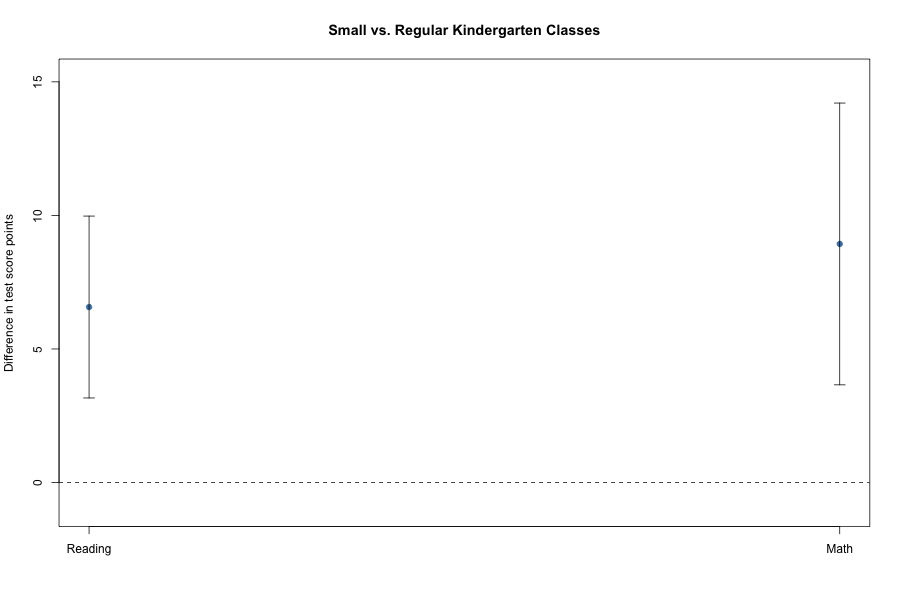

# Kindergarten Class Size & Student Achievement

---

---
## Research question

How do kindergarten reading and math scores differ across class types in Project STAR?

## Data

This project uses the public Project STAR dataset from the R package `AER`. Project STAR was a Tennessee class-size study that began in the 1980s. Students were assigned to small classes, regular classes, or regular classes with a teacher's aide.

The kindergarten sample includes 6,325 students with a recorded class type. The main reading model uses 5,789 observations, and the math model uses 5,871.

## Methods

I compare class types within schools using school fixed effects and school-clustered standard errors. I also:

- Check whether missing test scores differ across class types.
- Compare student characteristics across class types.
- Examine whether estimates change after adding gender and ethnicity controls.
- Explore whether the small-class difference varies by free-lunch eligibility.

## Main results

Compared with regular classes, small classes were associated with:

- **6.57 higher reading-score points** (standard error: 1.71).
- **8.93 higher math-score points** (standard error: 2.65).

Adding gender and ethnicity controls produced similar estimates. In the exploratory lunch-eligibility analysis, I did not find strong evidence that the small-class difference varied between the two eligibility groups.

*Points show estimated differences within schools. Lines show 95% confidence intervals based on school-clustered standard errors.*

## Limitations

The `AER` documentation describes kindergarten class type but does not clearly establish whether it records original assignment or class attended. Some test scores are missing. Similar missing-score rates across class types do not rule out selection. The lunch-eligibility analysis is exploratory.

## Reproduce the analysis

Install R and the packages `AER`, `lmtest`, and `sandwich`. Open the project folder in RStudio and run:

1. `01_prepare_data.R`
2. `02_lunch_analysis.R`
3. `03_missing_scores.R`

The scripts save tables and a figure in the `outputs` folder.

## Data source

Project STAR dataset distributed with the `AER` package, based on the online materials for Stock and Watson's *Introduction to Econometrics*.

## Author

Faisal M. Mulla
